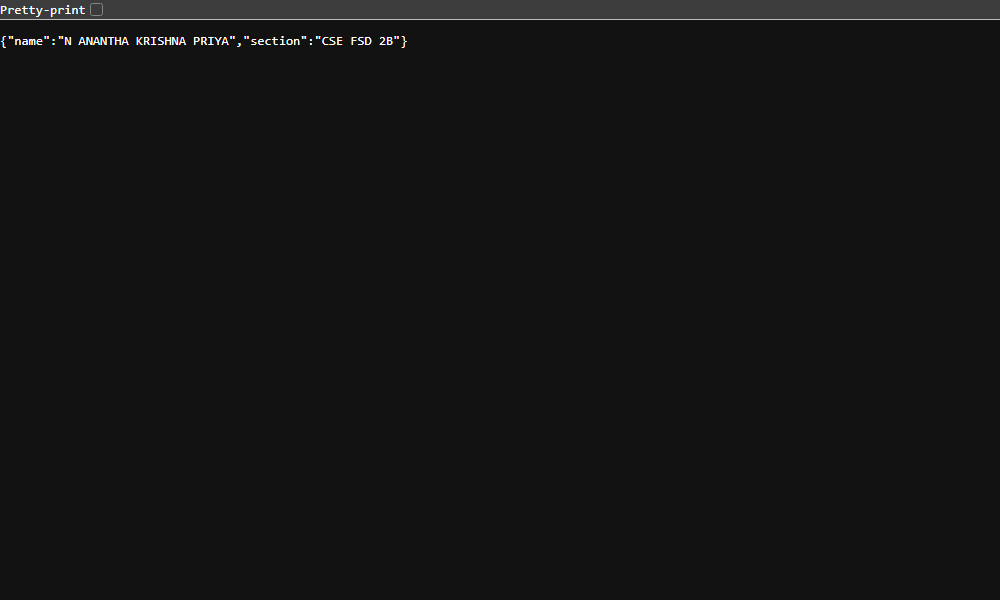
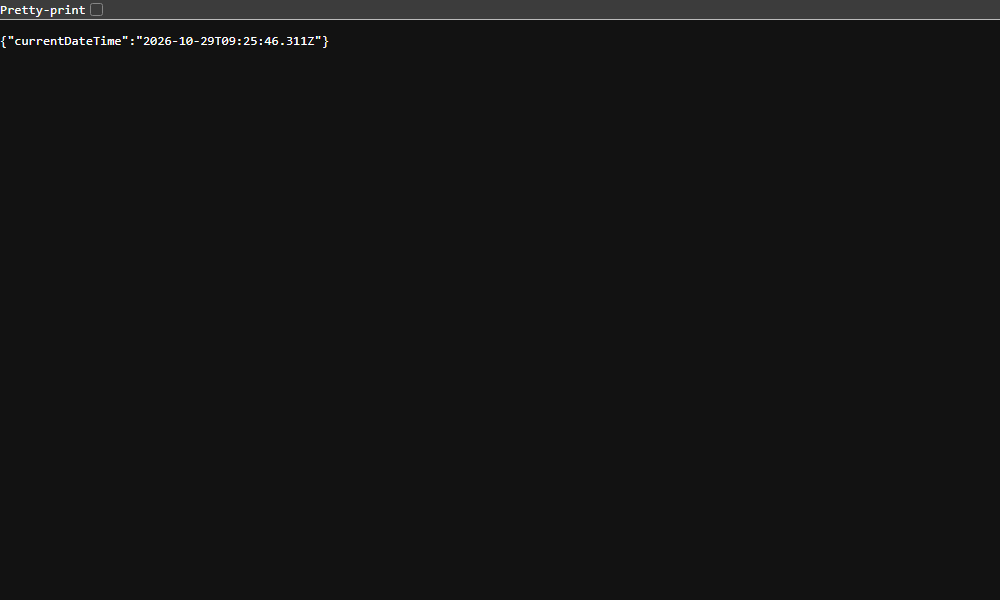

# Lab 1: Node.js and Express Server

## Student Details

- **Name:** N ANANTHA KRISHNA PRIYA
- **Registration Number:** 252U1R7067
- **Section:** CSE FSD 2B
- **Course:** Backend Development Fundamentals
- **Lab Number:** 01

## Live Link

**Deployment Status:** Local testing complete. Live deployment is pending cloud hosting configuration (e.g., Render, Vercel, or Railway) and user authorization.

## Objective

To set up a Node.js project, create a basic HTTP server using the built-in `http` module, and build an Express server with multiple routes and appropriate HTTP status codes.

## Technologies Used

- Node.js
- Express.js
- JavaScript
- npm
- Visual Studio Code

## Project Structure

```text
lab-01/
├── screenshots/
│   ├── home.png
│   ├── about.png
│   ├── time.png
│   └── not-found.png
├── server-http.js
├── server.js
├── package.json
├── package-lock.json
├── .gitignore
└── README.md
```

## Package Configuration (`package.json`)

Key fields in `package.json`:

- `name`: The name of the project (`lab-01`).
- `version`: The current version of the project (`1.0.0`).
- `description`: A brief summary of the project's purpose.
- `main`: Specifies the primary entry point file of the application (`server.js`).
- `scripts`: Command shortcuts defined to run tasks (e.g., `"start": "node server.js"` and `"start:http": "node server-http.js"`).
- `dependencies`: Lists required third-party packages and their semantic version ranges (e.g., `"express": "^5.3.0"`).
- `license`: Defines the legal license terms for the project (`ISC`).
- `type`: Designates the module system (`commonjs` for `require()` syntax).

## Installation and Setup

### Prerequisites

- Node.js and npm installed
- Visual Studio Code or another code editor

### Steps to Run

1. Open the terminal and navigate to the `lab-01` directory:
   ```bash
   cd lab-01
   ```
2. Install dependencies:
   ```bash
   npm install
   ```
3. Start the Express server:
   ```bash
   npm start
   # or
   node server.js
   ```
4. Open the following URL in your browser:
   `http://localhost:3000`

### How to Run the Basic HTTP Server

To run the server implemented using Node.js's built-in HTTP module:

```bash
npm run start:http
# or
node server-http.js
```

Open `http://localhost:3000` in your browser to view the `Hello` message.

> **Note:** Stop the running server with `Ctrl + C` before starting another server on the same port (3000).

## Endpoints

| Method | Endpoint | Description | Expected Status |
|---|---|---|---|
| GET | `/` | Welcome message | 200 OK |
| GET | `/about` | Student name and section in JSON | 200 OK |
| GET | `/time` | Current date and time | 200 OK |
| GET | `/anything` | Unknown route demonstration | 404 Not Found |

The `/anything` path is an example of an unknown route. All other undefined routes (e.g., `/contact`, `/random`, etc.) will also return a 404 Not Found response.

### Route Testing Instructions

- **GET `/`**: Visit `http://localhost:3000/`. Expected response: `Welcome to my Lab 1 server!` with HTTP status `200 OK`.
- **GET `/about`**: Visit `http://localhost:3000/about`. Expected response: JSON object containing `name` and `section` with HTTP status `200 OK`.
- **GET `/time`**: Visit `http://localhost:3000/time`. Expected response: JSON object containing `currentDateTime` with HTTP status `200 OK`.
- **GET `/anything`**: Visit `http://localhost:3000/anything`. Expected response: `404 - Page Not Found` with HTTP status `404 Not Found`.

## Screenshots

### 1. Home Route

Displays the welcome message.


### 2. About Route

Displays the student's name and section in JSON format.



### 3. Time Route

Displays the current date and time.



### 4. Unknown Route

Displays the 404 Page Not Found response.


## HTTP Status Codes

- **200 OK:** The request was successful and the server returned the requested data.
- **404 Not Found:** The server cannot find the requested resource or route.

## Viva Questions and Answers

### 1. What is the difference between `package.json` and `node_modules`?

`package.json` stores project metadata, configuration, scripts, and lists the dependencies and their version constraints for the project. `node_modules` is the directory where npm actually installs the physical code files of those dependencies and their transitive dependencies.

### 2. What does `app.listen()` do?

`app.listen()` binds and listens for incoming HTTP connections on a specified host and port, transitioning the Express application into a running state where it waits for client requests.

### 3. What do request and response represent?

`request` (or `req`) represents the incoming HTTP request from the client, containing headers, URL, parameters, and body. `response` (or `res`) represents the outgoing HTTP response that the server constructs and sends back to the client, including status codes, headers, and payload data.

## Problems Faced and Solutions

1. **Port 3000 Collision Between Servers:**
   - *Problem:* Both `server-http.js` and `server.js` listen on port 3000 by default. Attempting to run both concurrently results in an `EADDRINUSE` error.
   - *Solution:* Ensured that one server is stopped (using `Ctrl + C` or terminating the process) before starting the other.

2. **Headless Browser Screenshot Profile Access:**
   - *Problem:* When capturing automated browser screenshots using headless Microsoft Edge, sandbox write restrictions in protected program paths prevented saving images.
   - *Solution:* Specified an explicit `--user-data-dir` in the user temporary directory and direct target paths to `screenshots/`, allowing clean screenshot generation.

## Git and Repository Notes

- The `.gitignore` file excludes `node_modules/` and `.env`.
- The `node_modules/` directory must not be committed to Git.
- Screenshots are stored in the `screenshots/` directory using relative paths in markdown.
- The project follows clean and standard Node.js/Express practices for course submission.
